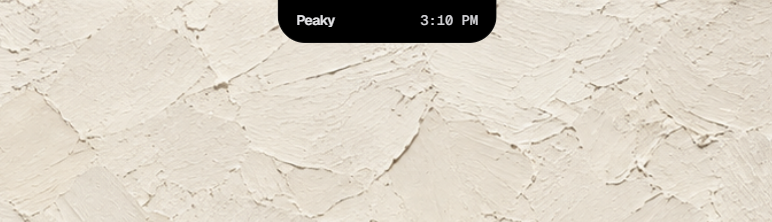

# Peaky

**Minimalist Dynamic Island & Productivity Overlay for Desktop.**

<br />

<p align="center">
  
</p>

<br />

<p align="center">
  <a href="https://tauri.app"></a>
  <a href="https://rust-lang.org"></a>
  <a href="https://nextjs.org"></a>
  <a href="https://react.dev"></a>
  <a href="https://typescriptlang.org"></a>
  <a href="https://tailwindcss.com"></a>
</p>

<p align="center">
  A discreet, tactile floating notch that seamlessly snaps to the top bezel of your screen — integrating a Focus Timer, Task Manager, iCal Meeting Sync, and Real-time Clipboard & Screenshot History into a fluid Dynamic Island.
</p>

---

## Features

### Dynamic Island
- Locks cleanly to the top display bezel (`y = 0`).
- Expands smoothly on hover into active widgets.
- **Horizontal Slide-Drag**: Left-click and drag the grip handle to reposition along your top display bezel.

### Focus Timer
- Minimal circular SVG progress ring with tactile play/pause controls.
- **Direct Inline Editing**: Click digits to customize session duration (1–180 min).
- Optional gentle acoustic completion chimes.

### Tasks & Quick Notes
- Instant keyboard task creation with `↵ Enter`.
- One-click completion toggles, hover copy, and quick deletion.
- Multi-window synchronized persistence.

### Calendar & Meeting Sync
- Direct iCal / webcal feed synchronization (Google Calendar, Outlook, iCloud).
- Real-time countdown to upcoming events directly on the collapsed pill.
- One-click `meet ↗` deep-link into Google Meet, Zoom, or Microsoft Teams calls.

### Clipboard & Screenshot History
- **Automatic Background Capture**: Real-time detection of copied text, URLs, code snippets, and desktop screenshots (`Win + Shift + S` or `PrintScreen`).
- **1-Click Copy**: Re-copy items with instant `✓ copied` visual confirmation.
- **Crisp Previews**: Thumbnails with resolution tags (`1920×1080`) and relative timestamps (`now`, `2m`, `1h`).

### CLI AI Agents HUD (Claude Code, OpenCode, Codex, Terminal)
- **Ambient Ambient Pill Monitoring**: Live breathing state indicator (Thinking, Executing Tool, Awaiting Approval, Done) with active step marquee on the collapsed notch.
- **Expanded Command Deck**: Real-time tool stream (bash, file edits, grep, searches), step counter, live token count, and cost estimate.
- **1-Click Action & Tool Approvals**: Approve or deny terminal commands and file edits directly from the Dynamic Island without switching windows.
- **Local Event Bridge (`127.0.0.1:3949`)**: Lightweight TCP/HTTP telemetry receiver in Tauri Rust with ready-to-use hooks for Claude Code, OpenCode, and shell profiles.
- **Built-in Interactive Simulator**: Test live state transitions, approvals, and animations out of the box.

### Settings Dashboard
- Dedicated matte obsidian settings window with `BroadcastChannel` live synchronization.
- Preferences for Calendar URLs, focus duration presets, clipboard history, CLI AI Agent hooks, and auto-start.

---

## Architecture

```
Peaky
├── Frontend (Next.js 16 + React 19 + TypeScript + Tailwind CSS)
│   ├── MacNotch: Floating Dynamic Island overlay
│   ├── Settings Dashboard: Multi-window preferences and data management
│   └── Hooks: useFocusTimer, usePeakyStore, useCalendar, useClipboardStore, useAgentStore
│
└── Backend (Tauri v2 + Rust)
    ├── Window Geometry: Top-bezel clamp & monitor boundary clamping
    ├── Clipboard Watcher: Background thread monitoring text & RGBA screenshot buffers
    ├── Local Agent Bridge: Non-blocking HTTP receiver on 127.0.0.1:3949
    └── Native Bridge: External browser launch & calendar curl fetcher
```

---

## Getting Started

### Prerequisites

- **Node.js**: `v20.x` or newer
- **Rust**: `v1.90` or newer with `cargo`
- **Windows / macOS** build tools

### Installation

1. Clone the repository:
   ```bash
   git clone https://github.com/your-username/peaky.git
   cd peaky/peaky_temp
   ```

2. Install dependencies:
   ```bash
   npm install
   ```

3. Run the desktop application:
   ```bash
   npm run desktop
   ```

4. Build production bundle:
   ```bash
   npm run desktop:build
   ```

---

## Shortcuts & Controls

| Action | Control |
| :--- | :--- |
| **Expand Notch** | Hover cursor over the collapsed top pill |
| **Reposition Notch** | Left-click and drag the grip handle along the top edge |
| **Collapse / Blur** | Move cursor away or press <kbd>Escape</kbd> |
| **Add Task** | Type in the input field and press <kbd>Enter</kbd> |
| **Edit Timer** | Click on timer digits when paused |
| **Take Screenshot** | Press <kbd>Win</kbd> + <kbd>Shift</kbd> + <kbd>S</kbd> (auto-saved to Clips) |
| **Copy Clip** | Click any item in the Clips list |

---

## License

Distributed under the MIT License. See `LICENSE` for more information.
